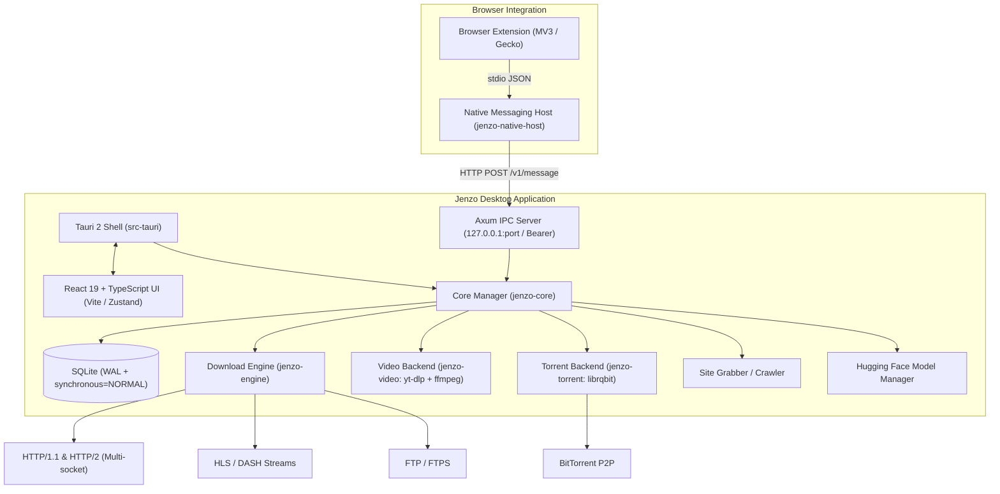

# Jenzo Download Manager — Codebase Architecture & Reference

> **Version:** 1.0.0  
> **Repository:** `jenzo-download-manager`  
> **Tech Stack:** Rust (Workspace, Tokio, Reqwest, Rusqlite, Axum, Librqbit), Tauri 2.12, React 19, TypeScript, Vite 8, Zustand, Browser Extension (MV3).

---

## 1. Executive Summary

Jenzo is an open-source, high-performance download manager built from the ground up to match and exceed proprietary tools like Internet Download Manager (IDM). It features a multi-connection dynamic segmentation engine (up to 32 parallel TCP sockets), deep browser integration via native messaging, video & audio grabbing (yt-dlp/ffmpeg), native BitTorrent support, Hugging Face AI model ingestion, remote ZIP central directory inspection over HTTP Range headers, and a liquid-glass desktop interface built with Tauri 2 and React 19.

---

## 2. High-Level Architecture



---

## 3. Repository Structure & Workspace Layout

```
.
├── Cargo.toml                  # Workspace definition (resolver = "3")
├── ARCHITECTURE.md             # High-level architecture specification
├── BUILD.md                    # Build guide for Windows and Linux
├── app/                        # Desktop UI & Tauri Shell
│   ├── package.json            # React 19, TypeScript 5.9, Vite 8, Zustand, Motion
│   ├── src/                    # Frontend source code
│   │   ├── components/         # Shared UI components (Menu, Toast, Tooltip, Modals)
│   │   ├── design/             # Design tokens and CSS styles
│   │   ├── lib/                # API client, store (Zustand), i18n, utilities
│   │   ├── locales/            # Localization files (en, ar, fr, de, es, etc.)
│   │   ├── views/              # Main desktop views (MainWindow, Sidebar, Toolbar, Table)
│   │   └── windows/            # Sub-window components (Capture, Video, Torrent, Model, etc.)
│   └── src-tauri/              # Tauri 2.12 backend
│       ├── Cargo.toml          # Tauri dependencies & plugins
│       └── src/                # commands.rs, windows.rs, main.rs, tray.rs, i18n.rs
├── crates/                     # Rust library & binary crates
│   ├── jenzo-engine/           # Core segmented download engine
│   ├── jenzo-core/             # Application logic, SQLite, queues, scheduler, IPC
│   ├── jenzo-video/            # yt-dlp & ffmpeg lifecycle, probe, plan & conversion
│   ├── jenzo-torrent/          # librqbit session wrapper for magnet/.torrent
│   ├── jenzo-native-host/      # Stdio Native Messaging host binary & registration
│   └── jenzo-testserver/       # Configurable test HTTP/FTP server for benchmarks
├── extension/                  # WebExtension (Chromium MV3 & Firefox MV3)
│   ├── package.json            # esbuild build pipeline, vitest & Playwright e2e
│   └── src/                    # background/, content/ (video button), popup/, options/
├── docs/                       # Guides, benchmarks, macOS build notes, design system
├── packaging/                  # NSIS/MSI (Windows), DEB/RPM/AppImage (Linux)
└── scripts/                    # Portable bundlers, benchmarks, sidecar helpers
```

---

## 4. Deep Dive into Core Crates

### 4.1 `crates/jenzo-engine` (The Download Engine)
- **Role:** Pure library without UI or database dependencies; manages network sockets and disk writes.
- **Dynamic Segmentation (Work Stealing):**
  - Files are partitioned into `[start, end)` segments where `end` is dynamically resized.
  - Idle workers steal half of the largest unfinished segment (`>= 2 * min_split`, 4 KiB aligned).
  - When segments become too small to split, workers can "race" slow tail segments.
- **1-RTT Zero-Round-Trip Probe:**
  - Starts with `GET Range: bytes=0-`. If HTTP 206 is returned, it extracts `Content-Length`/`Content-Range` and continues streaming worker #0 without disconnecting.
- **Direct Positioned Disk I/O:**
  - Allocates `<filename>.jenzopart` as a sparse file on NTFS (Windows) or `fallocate` (Linux) to prevent zero-fill stalls.
  - Positioned writes (`seek_write` on Windows, `write_all_at` on Unix) directly to target offsets; eliminates the post-download merge bottleneck.
- **Hierarchical Rate Limiting:**
  - Token-bucket limiter evaluated per download, per queue, and globally (<= 16 KiB per acquire).
- **Supported Protocols:** HTTP/1.1 (multi-socket), HTTP/2, FTP/FTPS (`suppaftp`), HLS (`m3u8-rs`), DASH (`dash-mpd`).

### 4.2 `crates/jenzo-core` (Application Core)
- **Role:** The brain of the application. Testable headlessly without launching the GUI.
- **Persistence (`db.rs`):** Single-connection SQLite (`rusqlite`) in WAL mode with `synchronous=NORMAL`.
- **Manager (`manager/`):**
  - Oversees active jobs, admissions, speed allocations, and status transitions.
  - Emits batched `CoreEvent` progress updates at 4 Hz (250 ms) to keep the UI smooth under heavy loads.
- **Remote ZIP Directory Inspection (`zipdir.rs`):**
  - Reads the ZIP end record and central directory from the remote file's tail using HTTP Range headers.
  - Powers the "What's inside" feature in the Download Dialog without downloading the archive.
- **Hugging Face Model Manager (`huggingface.rs`):**
  - Queries model/dataset repositories via API, displays GGUF quantizations/formats, queues files, and auto-verifies SHA-256 hashes.
- **Browser IPC Server (`ipc.rs`):**
  - Binds Axum to `127.0.0.1:<random_port>` using a 256-bit Bearer token written to `ipc.json`.
- **System Integrations:** Power management (sleep, shutdown, hibernate), clipboard URL listener, antivirus triggering (`MpCmdRun`, `clamscan`).

### 4.3 `crates/jenzo-video` (Video & Audio Ingestion)
- **Role:** yt-dlp, ffmpeg, and deno abstraction layer.
- **Tool Management:** Auto-downloads, updates, and SHA-256 verifies executable binaries.
- **Two Execution Modes:**
  - `Plan::Accelerated`: Downloads HTTP video and audio streams concurrently using `jenzo-engine`, then invokes ffmpeg for post-processing/muxing.
  - `Plan::YtDlp`: Direct fallback execution for non-standard or DRM/throttled streams.
- **Enhancements:** SponsorBlock API integration, chapters, subtitles, audio extraction.

### 4.4 `crates/jenzo-torrent` (P2P Engine)
- **Role:** Embedded BitTorrent client powered by `librqbit`.
- **Capabilities:** Fast resume persistence, magnet URI parsing, `.torrent` decoding, bandwidth throttling.

### 4.5 `crates/jenzo-native-host` (Browser Bridge)
- **Role:** Standalone lightweight Rust binary launched by browsers via Native Messaging (`dev.jenzo.host`).
- **Operation:** Relays stdio JSON messages from the extension to the local Axum IPC server via loopback HTTP.
- **Auto-Launch:** Automatically launches the main Jenzo desktop application in background mode if it is not running.

---

## 5. Frontend & UI Architecture (`app/`)

- **Framework:** React 19 + TypeScript + Vite 8.
- **State Management:** Zustand (`app/src/lib/store.ts`) with delta updates from Tauri events.
- **Multi-Window Navigation:**
  - Route parsing based on URL hash (`#capture`, `#video`, `#model`, `#torrent`, `#details`, etc.).
  - Secondary windows run as isolated WebViews loading only their respective code chunks via `lazy()`.
- **Virtualized Rendering:** `@tanstack/react-virtual` renders only visible rows in the download list, maintaining 60 FPS even with 10,000+ downloads.
- **Design System:** Custom "Liquid Glass" theme with translucent materials, CSS tokens, and Motion animations.
- **Localization:** Comprehensive i18n support including full Right-to-Left (RTL) for Arabic.

---

## 6. Browser Extension (`extension/`)

- **Manifest:** Manifest V3 (MV3) for Chromium (Chrome, Edge, Brave, Opera, Vivaldi) and Firefox.
- **Interception:**
  - Hooks `chrome.downloads.onDeterminingFilename` to capture browser downloads.
  - Sniffs video/audio media network requests and DOM elements to surface the floating download badge.
- **Communication:** Sends messages via `chrome.runtime.sendNativeMessage('dev.jenzo.host', ...)` to the native host.

---

## 7. Build, Test & Packaging Workflows

| Target | Command | Output Artifact |
|---|---|---|
| **Development** | `cd app && npm run tauri:dev` | Live development with HMR |
| **All Rust Tests** | `cargo test --workspace --exclude jenzo-app` | Unit & integration tests |
| **UI Tests** | `npm test --prefix app` | Vitest frontend suite |
| **Extension Tests**| `npm test --prefix extension` | Vitest & Playwright e2e |
| **Windows Build** | `cd app && npm run tauri:build` | NSIS `.exe` & `.msi` installers |
| **Portable Build**| `powershell ./scripts/make-portable.ps1` | Standalone portable `.zip` |
| **Linux Build** | `npx tauri build --bundles deb,rpm,appimage` | `.deb`, `.rpm`, `.AppImage` |
