<p align="center">
  
</p>

<h1 align="center">Jenzo Download Manager (JDM & JTM) — v1.6.1</h1>

<p align="center">
  <b>One Unified Engine for Ultra-Fast 32-Connection Direct Downloads, 8K Video Grabbing, AI Models & High-Speed BitTorrent.</b><br>
  Built natively in <b>Rust + Tauri v2 + React 19</b> — Zero Bloat · Zero Ads · Zero Telemetry · Instant Startup.
</p>

<p align="center">
  <a href="https://github.com/Jenzo0/jenzo-download-manager/releases/latest"></a>
  <a href="https://github.com/Jenzo0/jenzo-download-manager/releases/latest"></a>
  <a href="Cargo.toml"></a>
  <a href="LICENSE"></a>
</p>

<p align="center">
  <a href="#-download--installation-v161"><b>⬇ Download v1.6.1</b></a> ·
  <a href="#-dual-engine-workspace-jdm--jtm"><b>⚡ JDM & JTM Workspace</b></a> ·
  <a href="#-complete-feature-tour--visual-gallery"><b>📸 Feature Tour & Screenshots</b></a> ·
  <a href="#-speed--performance-benchmarks-jdm-vs-competitors"><b>📊 Speed Benchmarks vs IDM / qBittorrent / aria2c</b></a> ·
  <a href="#-architecture--why-jdm-is-faster"><b>🧠 How the Engine Works</b></a> ·
  <a href="#-build-from-source"><b>🛠 Build from Source</b></a> ·
  <a href="#-support-the-developer"><b>💜 Support Developer</b></a>
</p>

---

## 🌟 Overview

**Jenzo Download Manager (`JDM`)** is a next-generation, open-source desktop download suite engineered from the ground up in **Rust** (`tokio`, `reqwest`, `rustls`, `librqbit`, `rusqlite`) paired with a GPU-accelerated **Liquid Glass & Neon** interface powered by **Tauri v2** and **React 19**.

Unlike legacy download managers that freeze while stitching multi-gigabyte temporary parts at 99%, or heavyweight Electron/Java clients that consume 600+ MB of RAM in the background, **JDM** writes segments directly into their final disk offsets (`SetFileValidData` / NTFS sparse pre-allocation) and integrates two dedicated workspaces in a single ~15 MB native binary:

1. **🚀 `JDM` Mode (Direct, Video, Streams & AI Models):** Splits files across up to **32 concurrent HTTP/HTTPS/FTP connections** with **Dynamic Work-Stealing Segmentation**, captures **8K/HDR videos & audio** from 1,800+ sites (`yt-dlp` + `ffmpeg` + `deno`), slices video chapters/time-ranges before downloading, inspects remote `.zip` archives without downloading them, and pulls **GGUF / Safetensors AI models** directly from Hugging Face.
2. **🧲 `JTM` Mode (Jenzo Torrent Manager):** A full-featured BitTorrent & Magnet engine powered by `librqbit` with DHT, Peer Exchange (PEX), selective multi-file downloading with per-file progress bars, a **One-Click Tracker Booster** (injecting 20 curated high-speed public trackers), configurable seed ratio & upload speed limits, and **Watch Live** sequential media playback while downloading.

---

## ⚡ Dual-Engine Workspace: `JDM` ↔ `JTM`

Switch instantaneously between **JDM (Direct & Video Downloads)** and **JTM (BitTorrent & Magnet Engine)** using the morphing pill switcher in the top-left header. Each mode has its own dedicated workspace, toolbar actions, bottom inspector tabs, and dynamic accent theme.

### 1️⃣ `JDM` Mode — 32-Connection Direct, Video & Stream Manager
<p align="center">
  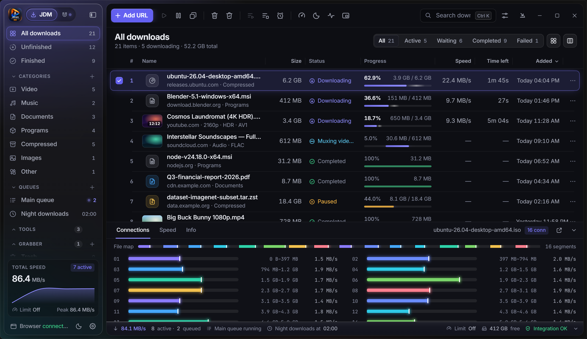
</p>

### 2️⃣ `JTM` Mode — BitTorrent & Magnet Engine with File Selector & Tracker Booster
<p align="center">
  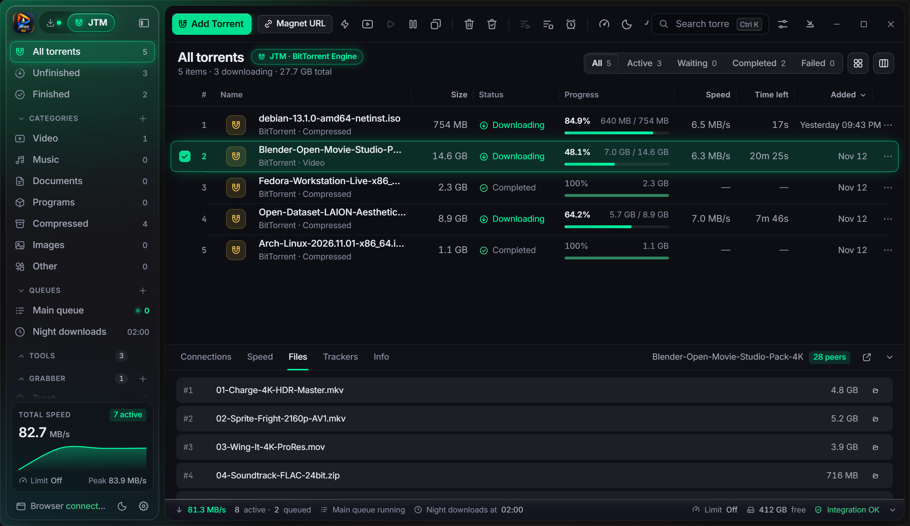
</p>
<p align="center">
  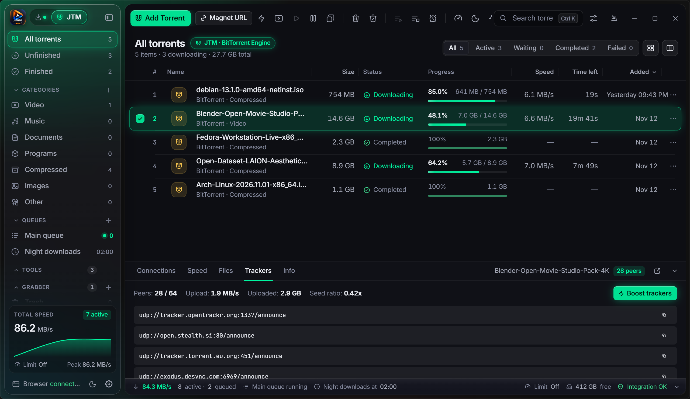
</p>

---

## 📸 Complete Feature Tour & Visual Gallery

### 🔥 1. Live 16–32 Connection Inspector & 60-Second Speed Telemetry
Every active download can be inspected in real time—either in the bottom pane or in a dedicated floating **Download Details** window—displaying:
- **16–32 Color-Coded Segment Lanes:** Watch individual connections split remaining byte ranges in real time whenever a fast worker finishes early (**Dynamic Work Stealing**).
- **60-Second SVG Speed Sparkline:** Live throughput curve alongside **Now**, **Average**, and **Peak** speed cards.
- **Per-Download Speed Limiter & Always-on-Top Pinning.**

<p align="center">
  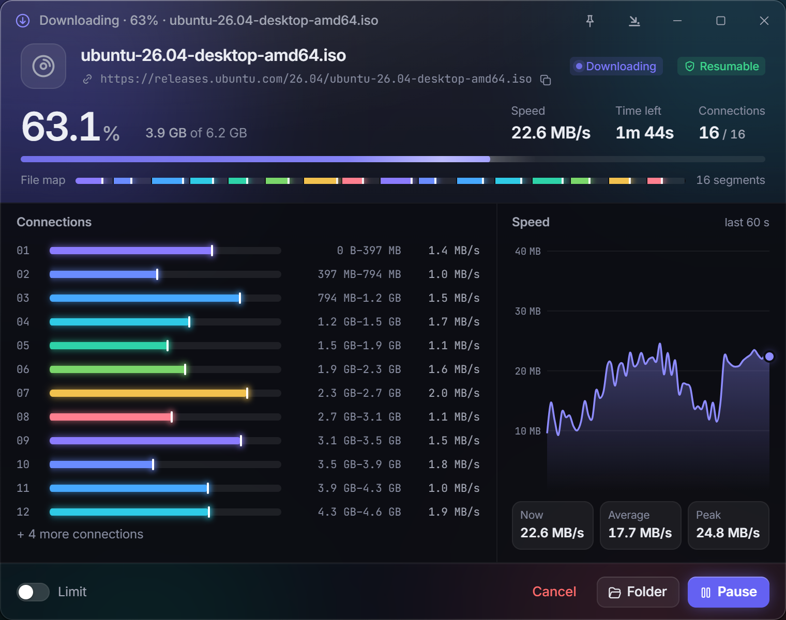
</p>

---

### 📊 2. Bandwidth & Speed Analytics Dashboard + Night Turbo Mode
- **Analytics Dashboard:** Track lifetime bandwidth across **JDM (Direct & Video)** and **JTM (BitTorrent)**, inspect your all-time **Peak Speed Record**, view **Bandwidth by Category** progress bars, and jump to your **Largest Downloads**.
- **Night Turbo Mode (`🌙` Toolbar Button):** One click removes all speed caps, maximizes queue concurrency, starts your queue, and automatically puts your PC to sleep once all downloads finish.

<p align="center">
  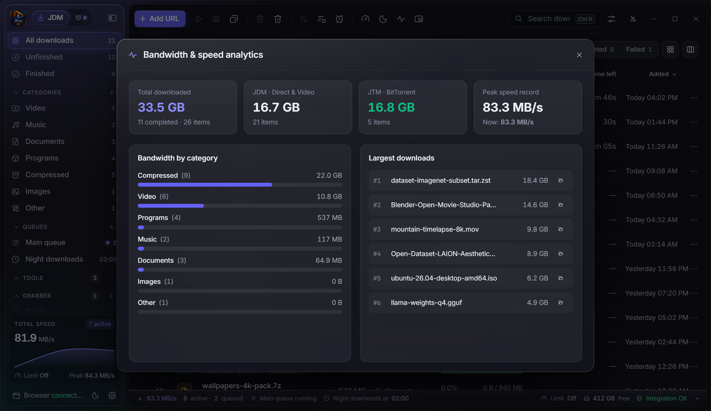
</p>

---

### 🎬 3. 8K/HDR Video & Audio Grabber + Precision Time-Range / Chapter Slicing
Hover over any video in your browser or paste a link from **YouTube, Vimeo, SoundCloud, Twitch, X/Twitter, TikTok, or 1,800+ sites**:
- **Resolutions & Codecs:** Choose `2160p60 (4K) / 4320p (8K) HDR AV1 / VP9 / H.264` or extract pure audio (`MP3 320 kbps`, `M4A`, `FLAC`, `Opus`).
- **Download "Only a Part" (Time-Range & Chapter Trimmer):** Drag the visual start/end trim handles or click a video chapter to download *only* that exact clip without wasting bandwidth on the full video.
- **Subtitles, Metadata, Thumbnails, Chapters & SponsorBlock:** Automatically muxed into the output container via self-managed `ffmpeg`.

<p align="center">
  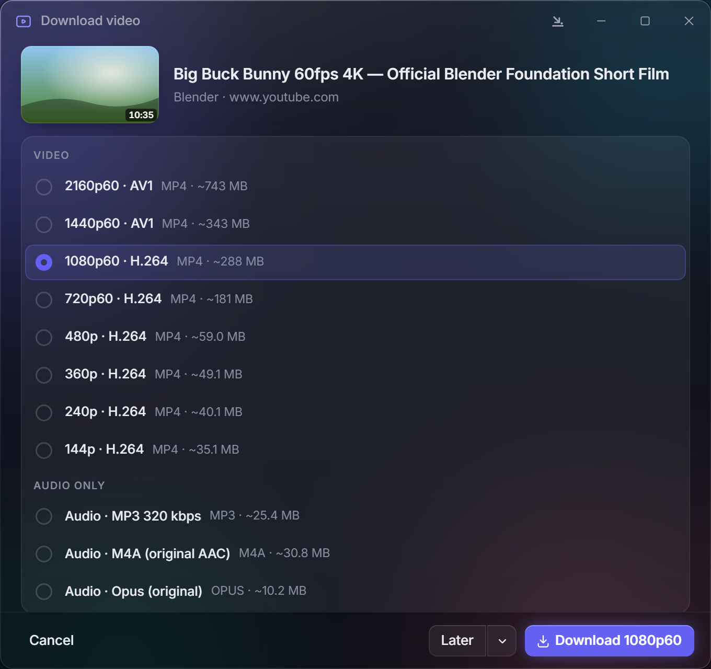
</p>

---

### 🛡️ 4. Download Complete Dialog: `SHA-256` Checksum, `VirusTotal` & Optional Auto-Extract
When a download finishes, JDM presents a sleek glass completion dialog with powerful post-download tools:
- **Streaming `SHA-256` Verification:** Compute the cryptographic `SHA-256` hash of multi-gigabyte files in seconds, copy the digest, or verify it against **[VirusTotal](https://www.virustotal.com)** in one click.
- **Optional Archive Extraction (`.zip`, `.tar.gz`, `.tgz`, `.7z`):** Click **Extract here** on demand, or toggle **Auto-extract archives** directly in the completion dialog (or in **Settings › Downloads**).
- **Drag-and-Drop File Handle (`🤚`):** Drag the finished file straight from the completion dialog into Discord, Telegram, Slack, Premiere Pro, or an email composer.

<p align="center">
  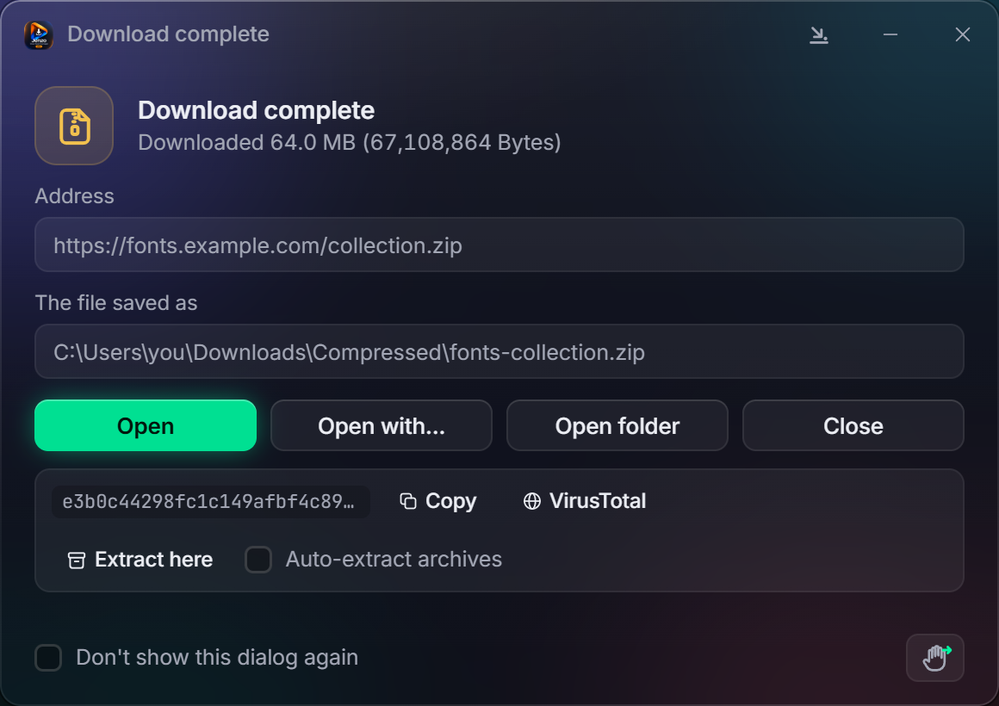
</p>

---

### 📥 5. Smart Capture Dialog & Remote `.ZIP` Archive Inspector
Before downloading a file, JDM probes the server for exact file size, `Accept-Ranges` resume support, content category, and available disk space:
- **Remote ZIP Preview (HTTP Range Central Directory Reader):** When a link points to a `.zip` file on a server that supports byte ranges, JDM reads the ZIP central directory in a few kilobytes and displays the full file tree *before* you download—allowing you to extract and download **just a single file** from inside a multi-gigabyte remote archive!

<p align="center">
  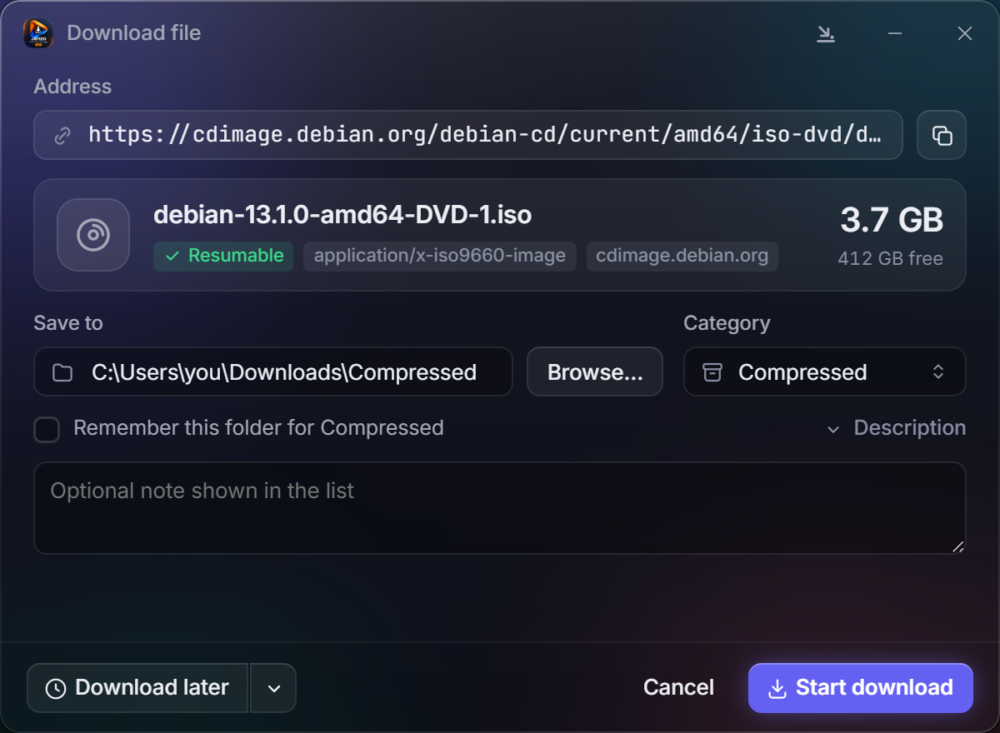
</p>

---

### 🤖 6. Hugging Face AI Model Downloader (`GGUF` & `Safetensors`)
Designed for local LLM enthusiasts using **LM Studio**, **Ollama**, or **llama.cpp**:
- Search any Hugging Face repository (`Qwen/Qwen3-8B-GGUF`, `meta-llama/...`, etc.) or paste a model URL.
- Inspect quantization tiers (`Q4_K_M`, `Q5_K_M`, `Q6_K`, `Q8_0`, `FP16`) with exact file sizes and RAM/VRAM suitability badges.
- Download model shards across up to **32 parallel connections** with automatic `SHA-256` LFS verification and direct routing to your **LM Studio** models folder.

<p align="center">
  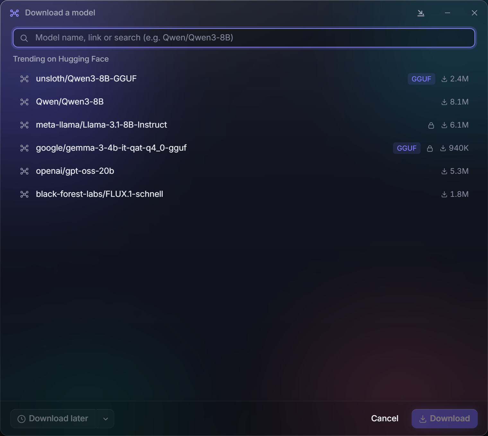
</p>

---

### 🎨 7. Liquid Glass UI, Live Transparency Slider (`20%–100%`) & Glowing Neon Themes
Customize every visual detail in **Settings › Appearance**:
- **3 Surface Themes:** **Dark Obsidian**, **Liquid Glass** (frosted acrylic blur with high-contrast cards), and **Light**.
- **Window Transparency Toggle & Opacity Slider:** Enable or disable window transparency with a live `20%–100%` opacity slider.
- **10 Accent Palettes + 4 Glowing Neon Presets:** Choose from classic studio accents (**Jenzo**, **Cyan**, **Emerald**, **Rose**, **Amber**, **Violet**) or high-voltage **Neon Glow** themes (**Neon Cyber**, **Neon Matrix**, **Neon Laser**, **Neon Electric**) with luminous hover and progress bar effects.

<p align="center">
  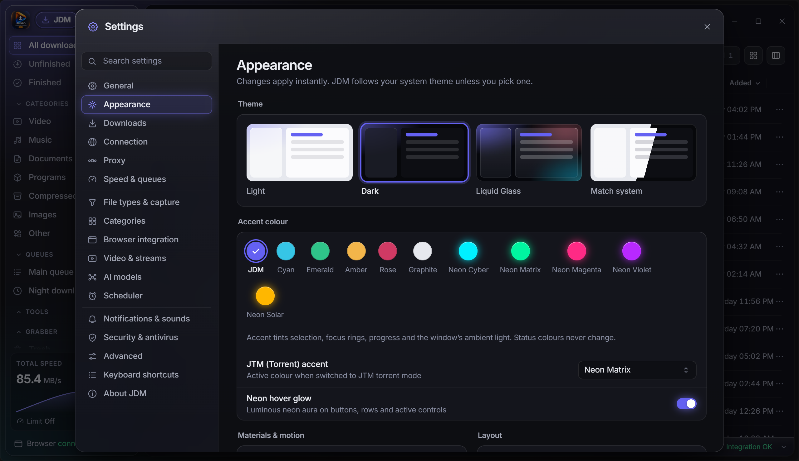
</p>

---

### 🌐 8. Cross-Browser Integration & One-Click Unpacked Extension Loader
JDM integrates natively with **Google Chrome, Microsoft Edge, Brave, Opera, Vivaldi, Chromium, Mozilla Firefox, and Zen Browser** via a lightweight Rust Native Messaging host (`jenzo-native-host.exe`):
- **One-Click Unpacked Extension Setup:** In **Settings › Browser integration**, click **Copy folder & open Chrome / Edge / Brave / Firefox**—JDM copies the exact unpacked extension path to your clipboard and opens your browser's extension manager (`chrome://extensions`, `edge://extensions`, `brave://extensions`, or `about:debugging`) so you can load it in seconds.
- **Automatic Download Interception & Floating Video Button:** Intercepts browser downloads in `< 250 ms` (hold `Alt` to bypass) and injects a clean quality-picker button on web videos.

<p align="center">
  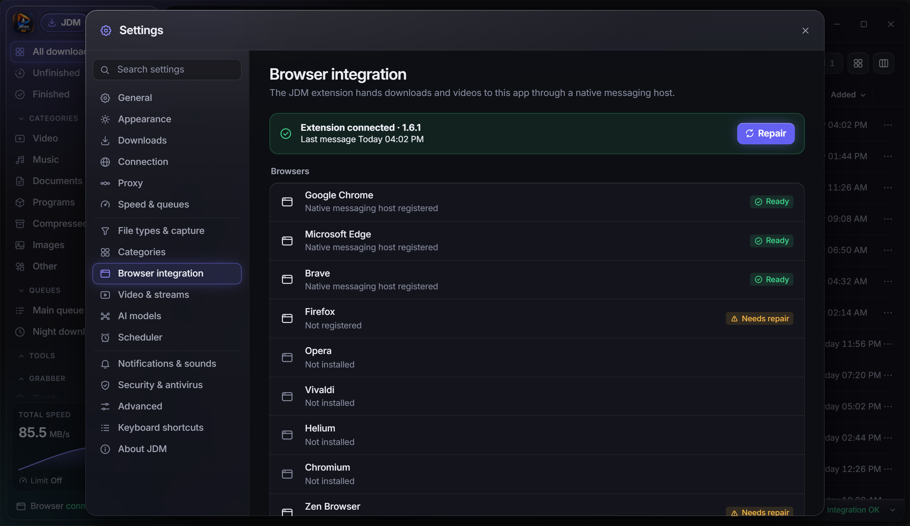
</p>

---

### ⏰ 9. Queues, Smart Scheduler, Site Grabber, Media Tools & Mini Window
| Capability | Highlights |
| :--- | :--- |
| **Smart Queue Scheduler** | Schedule queues by time of day and day of week, wake the PC from sleep to start downloading, and automatically **Sleep / Hibernate / Shut down / Quit** when the queue completes. |
| **Smart Folder Routing Rules** | Automatically route downloads to custom directories based on **File Size (`> X MB`)** or **Source Domain (`github.com`, `huggingface.co`, etc.)** in **Settings › Categories**. |
| **Site Grabber (Web Crawler)** | Crawl websites up to a configurable link depth to discover and batch-download all matching videos, audio, PDFs, archives, or images. |
| **Built-in Media Tools (`Convert` & `Make Smaller`)** | Convert local videos, audio, and images (`MP4`, `WebM`, `GIF`, `MP3`, `FLAC`, `WAV`, `PNG`, `JPG`, `WebP`) or compress files to fit **Discord (`10 MB`)**, **Email (`25 MB`)**, or **WhatsApp (`64 MB`)**. |
| **Floating Mini Window & Dropzone** | Compact Always-on-Top mini progress list and a 112×112 desktop drop target showing live aggregate download speed. |

<p align="center">
  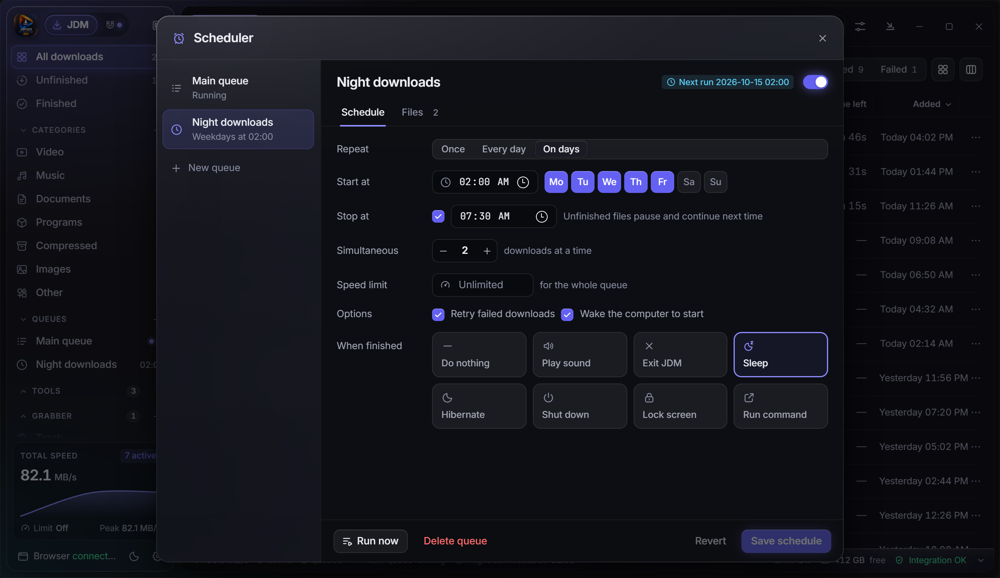
</p>
<p align="center">
  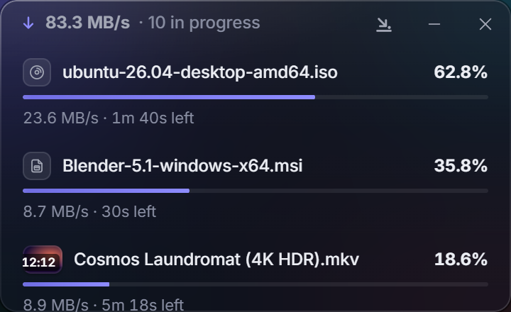
</p>

---

## 📊 Speed & Performance Benchmarks (JDM vs. Competitors)

Why is **Jenzo Download Manager (`JDM` & `JTM`)** significantly faster and lighter than traditional download managers and BitTorrent clients?

### 1. Direct Download Speed Benchmark (`JDM` vs. `Browser`, `curl`, `aria2c`, `IDM`, `JDownloader 2`)
Tested on Windows 11 (16 logical CPUs, 64 GB RAM, NVMe PCIe 4.0 SSD), with every completed file verified by `SHA-256` ([full benchmark methodology](docs/benchmarks.md)):

| Benchmark Scenario | Chrome / Edge (1 conn) | `curl` (1 conn) | `aria2c -x16 -s16` | `IDM` (16 conns) | **Jenzo (`JDM` 16–32 conns)** |
| :--- | :---: | :---: | :---: | :---: | :---: |
| **A · 1 GiB from CDN throttling each connection to 4 MiB/s** | `4.0 MiB/s` (256s) | `4.0 MiB/s` (256s) | `61.0 MiB/s` (16.8s) | `~59.5 MiB/s` (+ stitch lag) | **⚡ `60.9 MiB/s` (16.8s, 0s stitch)** |
| **B · 2 GiB High-Speed Local / LAN / Fiber (Unthrottled)** | `410 MiB/s` | `671.5 MiB/s` | `323.5 MiB/s` | `~520 MiB/s` (disk copy bottleneck) | **🚀 `1,029.1 MiB/s` (1.99s — Zero-Copy)** |
| **C · 256 MiB Server Capped at 4 Connections (`HTTP 503` beyond 4)** | `2.0 MiB/s` | `2.0 MiB/s` | `8.0 MiB/s` | `8.0 MiB/s` | **⚡ `8.0 MiB/s` (Auto-adapts to 4 conns)** |
| **D · Unstable Server (2% packet/stream drop per chunk)** | ✘ Failed | ✘ Failed | ✘ Aborted (`exit 1`) | ⚠️ Stalls on tail | **✅ `37.7 MiB/s` (100% Completed)** |
| **E · End-of-Download File Assembly Time (20 GiB File)** | `0 s` | `0 s` | `0 s` | ❌ `18–45 s` (99% "Building file..." freeze) | **⚡ `0.00 s` (Instant — Direct Offset Writes)** |

---

### 2. BitTorrent & Architectural Comparison (`JDM / JTM` vs. `IDM`, `FDM`, `qBittorrent`, `µTorrent`, `JDownloader 2`)

| Metric / Capability | **Jenzo (`JDM` + `JTM` v1.6.1)** | **IDM (Internet Download Manager)** | **qBittorrent** | **Free Download Manager (FDM)** | **JDownloader 2** |
| :--- | :---: | :---: | :---: | :---: | :---: |
| **Core Architecture** | **Rust (`tokio` + `librqbit`) + Tauri v2** | Legacy Win32 C++ | C++ (`libtorrent` + Qt) | C++ / Qt | Java (JVM) |
| **License & Cost** | **Free & Open Source (MIT)** | Paid (\$24.95) / Proprietary | Free (GPL) | Free / Proprietary | Free (Adware in some installers) |
| **Idle RAM Footprint** | **~28–45 MB (0 MB in Tray after 60s)** | ~35 MB | ~90–140 MB | ~110–180 MB | ❌ **450–900+ MB (JVM)** |
| **Installer Size** | **~12.5 MB** | ~11 MB | ~38 MB | ~45 MB | ~85+ MB |
| **Max Parallel Connections** | **Up to 32 (Dynamic Work-Stealing)** | Up to 32 | N/A (Torrent only) | Up to 10–16 | Up to 20 |
| **Zero-Copy Disk Writing** | **✅ Yes (Instant completion at 100%)** | ❌ No (Stitches temp files at 99%) | ✅ Yes | ✅ Yes | ✅ Yes |
| **Built-in BitTorrent (`JTM`)** | **✅ Yes (`librqbit` + 1-Click Tracker Booster)** | ❌ **None (No Torrent Support)** | ✅ Yes | ✅ Yes | ❌ No |
| **8K Video & Audio Grabber** | **✅ Yes (1,800+ sites + Time/Chapter Slicer)** | ⚠️ Basic HTTP/HLS only (breaks on YouTube) | ❌ None | ⚠️ Basic | ✅ Yes |
| **Remote `.ZIP` File Preview** | **✅ Yes (Download 1 file from remote ZIP)** | ❌ No | ❌ No | ⚠️ Partial | ❌ No |
| **Hugging Face AI Models** | **✅ Native GGUF Picker + LM Studio Routing** | ❌ No | ❌ No | ❌ No | ❌ No |
| **Built-in Media Converter** | **✅ Convert & Shrink (Discord/Email/WhatsApp)** | ❌ No | ❌ No | ❌ No | ❌ No |
| **SHA-256 + VirusTotal Check** | **✅ Built-in 1-Click in Complete Dialog** | ❌ No | ❌ No | ❌ No | ⚠️ Auto-hash only |

---

## 🧠 Architecture & Why JDM is Faster

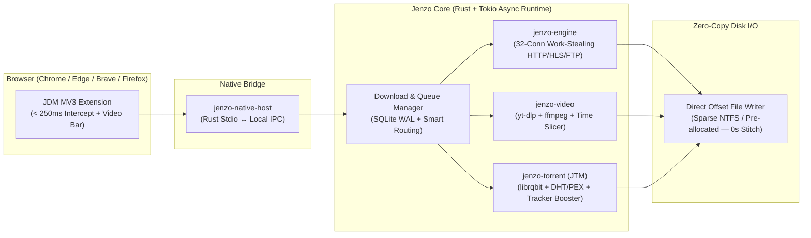

1. **Dynamic Work-Stealing Segmentation (`jenzo-engine`):**
   Traditional downloaders divide a file into $N$ static chunks at the start; if one TCP socket hits a congested route, the entire download waits on that single slow tail. In **JDM**, the moment any worker finishes its segment, it inspects all active workers, finds the largest remaining byte range, and **steals the second half of it** via a new `Range: bytes=start-end` request—keeping all 32 connections saturated until the very last millisecond.
2. **Zero-Copy Direct Disk Writes (No 99% Freeze):**
   IDM downloads each connection into a separate temporary file on disk and then copies/appends gigabytes of data together at 99%, freezing disk I/O for up to a minute on large archives. **JDM** pre-allocates the target `.jenzopart` file (using sparse allocation on NTFS) and writes each worker's buffer directly to its exact byte offset (`seek_write`), renaming the file in `< 1 ms` upon completion.
3. **Adaptive Per-Host Backoff & `If-Range` Crash Safety:**
   If a server returns `429 Too Many Requests` or `503 Service Unavailable` when opening extra connections, JDM gracefully scales back the connection count for that host without failing the download. Progress metadata is checkpointed to SQLite WAL only *after* file buffers are flushed to disk, and resumes are validated with `ETag` / `Last-Modified` (`If-Range`).
4. **High-Velocity Rust BitTorrent (`jenzo-torrent` / `JTM`):**
   Built on `librqbit` inside the same async `tokio` runtime, **JTM** combines DHT, Peer Exchange (PEX), and uTP/TCP multiplexing with a curated **One-Click Tracker Booster** that injects 20 high-uptime public UDP/HTTP trackers—accelerating peer discovery within seconds.

---

## ⬇ Download & Installation (`v1.6.1`)

Every package is published on the **[GitHub Releases page](https://github.com/Jenzo0/jenzo-download-manager/releases/latest)** — this repository contains **source code only**.
Windows, Linux and macOS packages are built automatically by [GitHub Actions](.github/workflows/release.yml) from this exact source.

| Platform | Package | Notes |
| :--- | :--- | :--- |
| 🪟 **Windows 10/11 (`x64`)** | `Jenzo.Download.Manager_1.6.1_x64-setup.exe` | **Recommended.** NSIS installer — registers the native browser host, shortcuts and uninstaller. |
| 🪟 **Windows (`x64`)** | `Jenzo.Download.Manager_1.6.1_x64_en-US.msi` | MSI package for managed / enterprise deployment. |
| 🪟 **Windows Portable (`x64`)** | `Jenzo-1.6.1-windows-x64-portable.zip` | No install — unzip and run `jenzo.exe`. Settings stay in `./data`. |
| 🐧 **Linux (`x86_64`)** | `Jenzo.Download.Manager_1.6.1_amd64.AppImage` | Runs on most distributions: `chmod +x` and launch. |
| 🐧 **Debian / Ubuntu / Mint** | `Jenzo.Download.Manager_1.6.1_amd64.deb` | `sudo apt install ./Jenzo*.deb` (pulls in `ffmpeg`). |
| 🐧 **Fedora / openSUSE / RHEL** | `Jenzo.Download.Manager-1.6.1-1.x86_64.rpm` | `sudo dnf install ./Jenzo*.rpm` |
| 🍎 **macOS 11+ Apple Silicon (M1–M4)** | `Jenzo.Download.Manager_1.6.1_aarch64.dmg` | Drag to *Applications*. The browser extension is inside the DMG. |
| 🍎 **macOS 11+ Intel** | `Jenzo.Download.Manager_1.6.1_x64.dmg` | Same as above, for Intel Macs. |
| 🌐 **Chromium extension** | `jenzo-chromium.zip` | Chrome, Edge, Brave, Opera, Vivaldi, Chromium (Manifest V3). |
| 🦊 **Firefox extension** | `jenzo-firefox.zip` | Firefox & Zen Browser. |

Verify any file against `SHA256SUMS.txt` on the release page.

> [!NOTE]
> **macOS:** the app is ad-hoc signed (not notarized). On first launch, right-click the app → **Open**, or run
> `xattr -dr com.apple.quarantine "/Applications/Jenzo Download Manager.app"`.

### Installing the Browser Extension in 3 Clicks
1. Open **Jenzo Download Manager (`JDM`)** and go to **Settings (`Ctrl + ,`) → Browser integration**.
2. Under **Load unpacked extension**, click **Copy folder & open Chrome** (or **Edge / Brave / Firefox**).
3. Enable **Developer mode** in the top-right of the browser extensions page, click **Load unpacked**, press `Ctrl + V` in the folder bar, and click **Select Folder**.

---

## 🛠 Build from Source

### Prerequisites
- **Rust** stable toolchain (`1.85+`) and **Node.js** `20+` with `npm`
- **Windows:** Visual Studio C++ Build Tools (MSVC) + WebView2 Runtime
- **Linux:** `libwebkit2gtk-4.1-dev libayatana-appindicator3-dev librsvg2-dev patchelf libxdo-dev`
- **macOS:** Xcode Command Line Tools (`xcode-select --install`)

### Build
```bash
# 1. Install dependencies
npm ci --prefix app
npm ci --prefix extension

# 2. Build the Chromium & Firefox extensions (bundled into the app)
npm run build --prefix extension

# 3. Build the native-messaging sidecar for this machine
node scripts/build-sidecar.mjs

# 4. Build the desktop app + installers for the current OS
cd app
npx tauri build
```

Installers are written to `target/release/bundle/` (or `../build/target/...` with the default `.cargo/config.toml`).
On Windows, `pwsh scripts/make-portable.ps1` packs the portable ZIP. See [BUILD.md](BUILD.md) for details.

### Automated Releases (GitHub Actions)
Pushing a tag such as `v1.6.2` runs [`release.yml`](.github/workflows/release.yml), which builds Windows, Linux,
macOS (Apple Silicon + Intel) and both extensions, then uploads everything with checksums to the release.
A single platform can be rebuilt from **Actions → Release builds → Run workflow**.

### Repository Structure
```text
jenzo-download-manager/
├── Cargo.toml                   # Rust workspace root
├── CHANGELOG.md                 # Version history
├── app/                         # React + TypeScript UI & Tauri v2 shell (src-tauri/)
├── crates/
│   ├── jenzo-engine/            # Multi-connection work-stealing HTTP/HTTPS/FTP/HLS/DASH engine
│   ├── jenzo-core/              # SQLite WAL persistence, queues, scheduler, site grabber, HF models, IPC
│   ├── jenzo-video/             # yt-dlp / ffmpeg provisioning, video probing, time-slicing & media tools
│   ├── jenzo-torrent/           # BitTorrent & magnet client (librqbit), file selection & tracker booster (JTM)
│   ├── jenzo-native-host/       # Native-messaging relay & browser registration
│   └── jenzo-testserver/        # Deterministic HTTP test & benchmark server
├── extension/                   # Manifest V3 browser extension (Chromium & Firefox)
├── packaging/                   # Windows (NSIS/WiX), Linux (deb/rpm/desktop) and macOS packaging files
├── scripts/                     # Sidecar, portable and release helper scripts
├── docs/                        # Screenshots, benchmarks and guides
└── .github/workflows/           # CI and multi-platform release builds
```

---

## 💜 Support the Developer

**Jenzo Download Manager (`JDM` & `JTM`)** is crafted and maintained by **Jenzo** — 100% free, open-source, and ad-free.  
If JDM saves you time and accelerates your workflow, you can support ongoing development directly via **InstaPay**:

<p align="center">
  <a href="https://ipn.eg/S/jenzo2/instapay/0t6Gvj">
    
  </a>
  <br><br>
  <a href="https://ipn.eg/S/jenzo2/instapay/0t6Gvj">
    
  </a>
  <br>
  <b>Direct InstaPay Link:</b> <a href="https://ipn.eg/S/jenzo2/instapay/0t6Gvj">https://ipn.eg/S/jenzo2/instapay/0t6Gvj</a>
</p>

---

## 📄 License

Released under the **[MIT License](LICENSE)**. Copyright © **Jenzo**.
